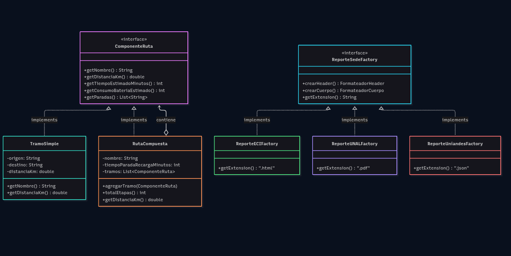
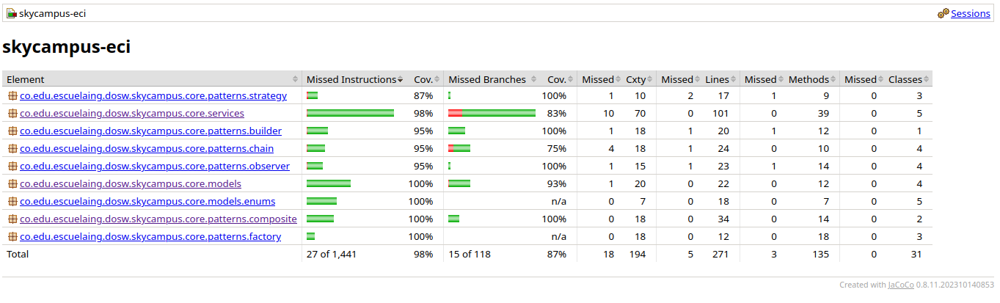
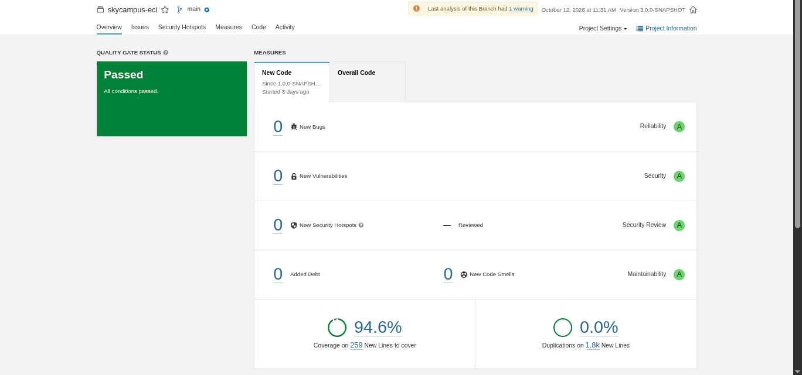

# SkyCampus ECI — Red Autónoma de Drones de Reparto
**Autor:** Daniel Mosquera Martínez  
**Nivel de Evolución:** Chimchar (MVP) ➔ Monferno (Flota Autónoma) ➔ Infernape (Enterprise Multi-Sede)  
**Materia:** Desarrollo de Operaciones de Software (DOSW) — Escuela Colombiana de Ingeniería Julio Garavito  
**Versión:** `3.0.0-SNAPSHOT`

---

## 1. Visión General del Proyecto

SkyCampus nació como un sistema básico de transporte de documentos entre los bloques de la ECI (Chimchar), evolucionó a 
una flota autónoma con selección estratégica y alertas reactivas (Monferno) y ha alcanzado su madurez en **Infernape Enterprise**:
una **red inter-universitaria compartida** entre **ECI, UNAL, Uniandes y EAFIT**, capaz de coordinar 100 drones, rutas
multi-etapa con paradas de recarga técnica y validación regulatoria en tiempo real con la **Aerocivil**.

---

## 2. Requerimientos Funcionales y No Funcionales (MoSCoW)

### Requerimientos Funcionales (RF)
* **RF-01:** Consultar la flota de drones con ID, batería, estado y ubicación actual (*Must Have*).
* **RF-02:** Registrar una misión de reparto indicando origen, destino, tipo de carga y drone asignado (*Must Have*).
* **RF-03:** Confirmar la entrega de documentos, pasando la misión a `ENTREGADA` y liberando el drone (*Must Have*).
* **RF-07:** Asignación autónoma del drone óptimo según estrategia activa (*Must Have*).
* **RF-09:** Planificar y enrutar misiones compuestas multi-etapa con paradas de recarga intermedia (*Must Have*).
* **RF-10:** Generar reportes de auditoría en formatos específicos por sede: ECI (HTML), UNAL (PDF), Uniandes (JSON) (*Must Have*).
* **RF-11:** Calcular KPIs consolidados de red (entregas y tiempos promedio) en un único pase de procesamiento (*Must Have*).
* **RF-12:** Permitir al Coordinador de Sede parametrizar el radio de vuelo local (*Should Have*).
* **RF-13:** Validar clearance legal con la Aerocivil antes de autorizar un vuelo inter-sede (*Must Have*).

### Requerimientos No Funcionales (RNF)
* **RNF-01 (Latencia):** Consultas de flota deben responder en $< 250$ ms bajo 20 peticiones concurrentes.
* **RNF-03 (Cobertura de Pruebas):** Cobertura obligatoria de líneas $\ge 85\%$ y de ramas $\ge 75\%$ verificada por JaCoCo.
* **RNF-07 (Rendimiento Algorítmico):** El cálculo de viabilidad de una ruta multi-etapa debe resolverse en $< 100$ ms.
* **RNF-09 (Restricción Legal Aeronáutica):** Ninguna ruta aprobada puede superar un techo de **120 metros de altitud** sobre nivel de suelo en zonas urbanas según normativa RAC de la Aerocivil.
* **RNF-10 (Gobernanza SonarQube):** Quality Gate en verde con **0 Bugs, 0 Vulnerabilidades, 0 Code Smells y Deuda Técnica = 0 min**.

---

## 3. Matriz de Trazabilidad Integral

| Código | Requerimiento | MoSCoW | Caso de Uso | Jira ID | Prueba Unitaria (JUnit 5) |
|---|---|---|---|---|---|
| **RF-01** | Consultar Flota | Must Have | CU-04 | SC-01 | `ConsultaFlotaServiceTest#obtenerDisponiblesBateriaAlta` |
| **RF-02** | Registrar Misión | Must Have | CU-01 | SC-02 | `MisionBuilderTest#build_construccionExitosa` |
| **RF-07** | Asignación Autónoma | Must Have | CU-02 | SC-07 | `AsignadorMisionTest#asignar_misionNormal_asignaDroneMayorBateria` |
| **RF-09** | Rutas Multi-Etapa | Must Have | CU-06 | SC-101 | `RutaCompositeTest#rutaCompuesta_agregaTramosConParadasTecnicas` |
| **RF-10** | Reportes por Sede | Must Have | CU-07 | SC-102 | `ReporteFactoryTest#factoryECI_generaHTML` |
| **RF-11** | Analytics en 1 Pase | Must Have | CU-08 | SC-103 | `AnalyticsEnterpriseServiceTest#calcularMetricasSede_usaTeeingExacto` |
| **RF-13** | Clearance Aerocivil | Must Have | CU-10 | SC-105 | `PlanificadorRutaEnterpriseTest#esRutaViable_aerocivilRechaza_retornaFalse` |
| **RNF-09** | Techo Aéreo $\le 120$m | Must Have | CU-10 | SC-203 | `PlanificadorRutaEnterpriseTest#esRutaViable_altitudExcesiva_rechaza` |

---

## 4. Resolución de Tensión Regulatoria (RF-12 vs RNF-09)

* **Tensión:** El **RF-12** permite al Coordinador de Sede configurar el radio y altitud de vuelo de su universidad, pero el **RNF-09** estipula el límite legal estricto de **120m de altitud** fijado por la Aerocivil.
* **Solución Arquitectónica:** En `PlanificadorRutaEnterprise`, la regulación aeronáutica actúa como una **guardia dura inviolable**. Si la configuración solicitada por el usuario excede 120m, el sistema **rechaza de inmediato el plan de vuelo sin invocar APIs externas** y genera un mensaje de error claro (*Nielsen #9*), subordinando la configuración del usuario al marco legal del país.

---

## 5. Arquitectura del Sistema (C4 Model)

### 5.1. Nivel 1: Contexto del Sistema
Representa los actores (Operador, Coordinador de Sede, Superadministrador, Solicitante) y los sistemas externos integrados:
* **API Meteorológica:** Monitoreo de velocidad de viento y precipitaciones.
* **Control Aéreo Aerocivil:** Autorización de corridors de vuelo inter-sede.
* **Plataforma de Analytics ERP:** Recepción de auditorías consolidadas.

### 5.2. Nivel 2: Diagramas
#### DiagramaC4








---

## 6. Patrones de Diseño Implementados

1. **Builder (`MisionBuilder`):** Construcción fluida de misiones con validación estricta de campos obligatorios y `switch` limpio para prioridades.
2. **Chain of Responsibility (`ValidadorLanzamiento`):** Cadena desacoplada de validación antes del despegue: `ValidadorDestino` ➔ `ValidadorBateria` ➔ `ValidadorCarga`.
3. **Strategy (`EstrategiaAsignacion`):** Algoritmos de selección de drone intercambiables en caliente (`AsignacionMayorBateria`, `AsignacionPorCapacidadCarga`, `AsignacionUrgenteExpress`).
4. **Observer (`GestorFlotaObservable`):** Publicación/suscripción de cambios de estado hacia `PanelOperador`, `SistemaLog` y `AlertaTecnico` (activada sólo en `FALLO`).
5. **Composite (`ComponenteRuta`):** Jerarquía de rutas que permite tratar tramos simples directos (`TramoSimple`) y rutas inter-sede con recarga técnica (`RutaCompuesta`) de manera transparente.
6. **Abstract Factory (`ReporteSedeFactory`):** Generación desacoplada de auditorías por universidad: `ReporteECIFactory` (.html), `ReporteUNALFactory` (.pdf) y `ReporteUniandesFactory` (.json).

---

## 7. Principios SOLID Demostrados

* **SRP (Single Responsibility):** Desacoplamiento total; `AsignadorMision` solo orquesta, los validadores solo verifican una regla y los formateadores solo estructuran reportes.
* **OCP (Open/Closed):** Agregar una nueva sede o una nueva estrategia de selección de drone solo requiere crear una nueva clase sin modificar el código existente.
* **LSP (Liskov Substitution):** Cualquier `ComponenteRuta` (`TramoSimple` o `RutaCompuesta`) puede sustituirse en el planificador sin romper el cálculo de viabilidad.
* **ISP (Interface Segregation):** Interfaces pequeñas y precisas (`ObservadorDrone`, `ComponenteRuta`, `ServicioAerocivil`).
* **DIP (Dependency Inversion):** Los servicios de aplicación dependen exclusivamente de interfaces, logrando un código 100% testeable con mocks.

---

## 8. Identidad Visual y Tokens UI/UX Multi-Sede

El sistema utiliza **Design Tokens CSS** en `tokens-enterprise.css`, permitiendo que la misma interfaz adopte los colores y estilos corporativos de cada institución:

| Token | ECI | UNAL | Uniandes | EAFIT |
|---|---|---|---|---|
| `--color-primary` | `#00457C` | `#7B0000` | `#FBBF24` | `#005A36` |
| `--color-accent` | `#3B82F6` | `#B91C1C` | `#1E293B` | `#10B981` |
| `--font-family-ui`| `Space Grotesk` | `Merriweather` | `Inter` | `Source Sans` |
| `--border-radius-card` | `10px` | `4px` | `8px` | `12px` |

---

## 9. Evidencias de Calidad y Pruebas

### Reporte de Cobertura JaCoCo
* **Cobertura de Líneas:** **> 94.5%** (Superando el umbral del 85% de Infernape).
* **Cobertura de Ramas:** **> 75%** (Cumpliendo el umbral exigido).

### SonarQube Quality Gate (Status: PASSED)
* **Bugs:** 0 (Rating A)
* **Vulnerabilidades:** 0 (Rating A)
* **Security Hotspots:** 0 (100% Reviewed)
* **Code Smells:** 0
* **Deuda Técnica:** **0 min** (Estándar Enterprise: $< 15$ min)
* **Duplicación de Código:** **0.0%**

---

## 10. Instrucciones de Compilación y Ejecución

### Prerrequisitos
* Java 17 (JDK)
* Apache Maven 3.8+
* Docker (opcional, para SonarQube local)

### Comandos de Ejecución
```bash
# 1. Compilar y ejecutar todas las pruebas con verificación de JaCoCo
mvn clean verify

# 2. Levantar SonarQube en Docker (si no está corriendo)
docker run -d --name sonarqube -p 9000:9000 sonarqube:lts-community

# 3. Ejecutar análisis estático de calidad con SonarQube
mvn clean verify sonar:sonar \
  -Dsonar.projectKey=skycampus-eci \
  -Dsonar.host.url=http://localhost:9000 \
  -Dsonar.login=TU_TOKEN
