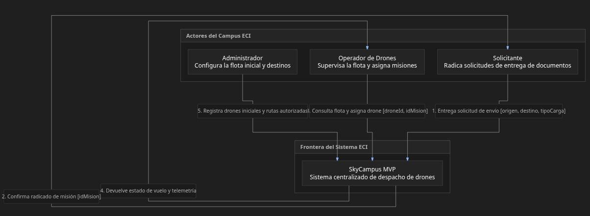
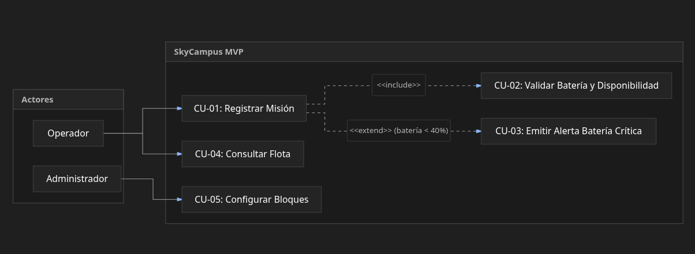
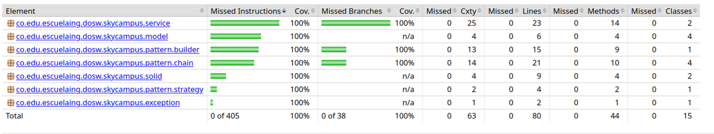
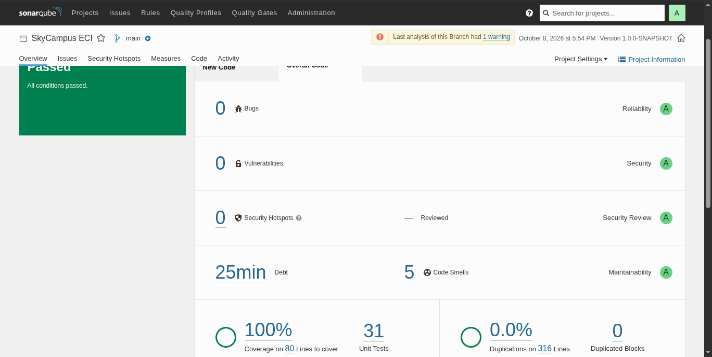

# SkyCampus ECI — Sistema de Drones de Reparto
**Autor:** Daniel Mosquera Martínez  
**Nivel de Evolución:** Chimchar (MVP) →  Monferno (Listo para evolución)  
**Materia:** Desarrollo de Operaciones de Software (DOSW) — Escuela Colombiana de Ingeniería Julio Garavito

---

## 1. Requerimientos Funcionales y No Funcionales

### Requerimientos Funcionales (RF)
- **RF-01:** El Operador debe poder consultar en pantalla la lista de todos los drones del campus con su ID, porcentaje de batería, estado de disponibilidad y bloque actual.
- **RF-02:** El Operador debe poder registrar una misión de reparto indicando origen, destino, tipo de carga (`SOBRE`, `CARPETA`, `LIBRO`) y drone asignado.
- **RF-03:** El Operador debe poder confirmar la entrega de un documento, cambiando el estado de la misión a `ENTREGADA` y liberando el drone (`disponible = true`).

### Requerimientos No Funcionales (RNF)
- **RNF-01 (Latencia / Rendimiento):** La consulta del estado de la flota debe responder en menos de 250 milisegundos bajo una carga de hasta 20 consultas concurrentes.
- **RNF-02 (Concurrencia segura):** El sistema debe prevenir condiciones de carrera impidiendo que dos operadores asignen el mismo drone al mismo tiempo mediante bloqueos a nivel de servicio.
- **RNF-03 (Cobertura de pruebas):** La lógica de validación y servicios de dominio debe mantener un mínimo de 80% de cobertura de líneas medido mediante el plugin JaCoCo en Maven.

### Priorización MoSCoW
| Prioridad | Requerimientos | Justificación |
|---|---|---|
| **Must Have** | RF-01, RF-02, RF-03, RNF-03 | Núcleo indispensable para que el MVP opere y garantice calidad técnica. |
| **Should Have** | RNF-01, RNF-02 | Robustez y consistencia operativa ante concurrencia. |
| **Could Have** | Filtro avanzado por tipo de carga | Mejoras visuales en UI/UX secundarias. |
| **Won't Have** | Asignación autónoma sin operador, recálculo dinámico meteorológico | Reservados para el nivel Monferno / Infernape. |

---

## 2. Arquitectura y Modelado

### 2.1. Diagrama de Contexto C4 (Nivel 1)
Representa a los actores del campus (Operador, Administrador, Solicitante) interactuando con el sistema SkyCampus MVP como caja negra.

### 2.2. Diagrama de Casos de Uso (UML)
Modela los casos de uso principales, destacando la inclusión obligatoria de validación (`<<include>>`) y la extensión
condicional de alerta de batería (`<<extend>>`).

---

## 3. Manual de Identidad y Principios UX/UI

### Paleta de Colores y Tokens Visuales
- **Fondo / Superficie:** Dark Dashboard (`#06080E`, `#0D1018`)
- **Primario / Acción:** Azul Técnico (`#3B82F6`)
- **Disponible / Éxito:** Verde Esmeralda (`#22C55E`)
- **En Vuelo / Proceso:** Azul Cielo (`#4A9EFF`)
- **Batería Crítica / Error:** Rojo Carmesí (`#F43F5E`)
- **Tipografía:** `Space Grotesk` (UI y títulos), `JetBrains Mono` (IDs de drones, radicados y métricas).

### Cumplimiento de Heurísticas de Nielsen
1. **#1 Visibilidad del estado del sistema:** Indicadores en tiempo real del porcentaje de batería y estado (`DISPONIBLE`, `EN_VUELO`) por cada drone.
2. **#5 Prevención de errores:** Deshabilitación de selección para drones con batería < 30% en el builder de misiones.
3. **#8 Diseño estético y minimalista:** Tarjetas de flota concisas mostrando únicamente ID, batería, estado y ubicación actual.
4. **#9 Ayuda a reconocer y recuperarse de errores:** Mensajes claros de excepción (ej. *"Destino no permitido en el campus ECI: Plaza Mayor"*).

---

### 4. Evidencias de pruebas
- **Jacoco**

- **Sonar**

Analisis en ./docs/AnalisisReq